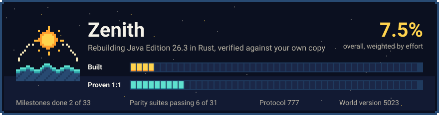
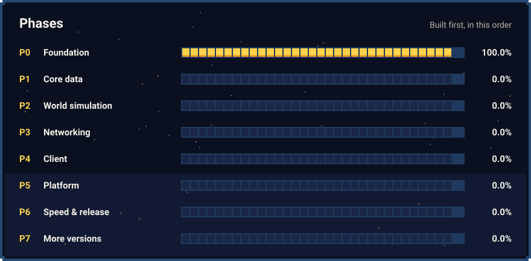
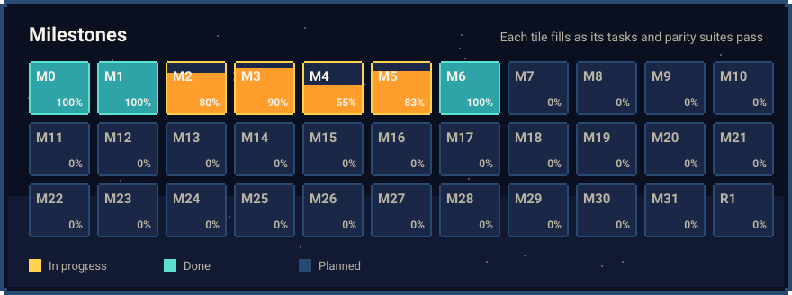
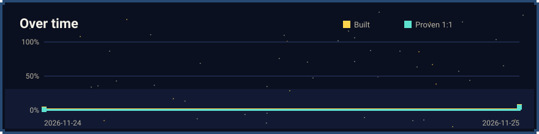

<p align="center">
  
</p>

<h1 align="center">Zenith</h1>

<p align="center">
  <b>Your copy of the game, rebuilt 1:1 in Rust.</b><br>
  An independent engine compatible with Minecraft: Java Edition. Same worlds, same rules, same pixels. Faster.<br>
  Requires your own copy. Ships none of the game's files.
</p>

<p align="center">
  <a href="https://distorbed678.github.io/Zenith/">Website</a> ·
  <a href="https://distorbed678.github.io/Zenith/tracker">Live tracker</a> ·
  <a href="docs/plan/00-OVERVIEW.md">Plan</a> ·
  <a href="docs/guide/requirements.md">Requirements</a> ·
  <a href="CONTRIBUTING.md">Contributing</a>
</p>

<p align="center">
  <a href="https://github.com/Distorbed678/Zenith/actions/workflows/ci.yml"></a>
  <a href="https://github.com/Distorbed678/Zenith/actions/workflows/pages.yml"></a>
  
  
</p>

---

## Progress

These cards are generated from [`progress/milestones.toml`](progress/milestones.toml) and the parity test results by
`cargo xtask progress`. **Built** counts finished work, weighted by effort. **Proven 1:1** only counts what the parity
suites have verified against the real game. The [live tracker](https://distorbed678.github.io/Zenith/tracker) shows
the same data, interactively.

<p align="center"></p>
<p align="center"></p>
<p align="center"></p>
<p align="center"></p>

<details>
<summary><b>Every milestone and task</b></summary>

<!-- tracker:start -->

_Generated by `cargo xtask progress`. Don't edit by hand._

#### P0 Foundation: 100.0%

Repo, rules, plan, hygiene guard, ownership proof, tracker, website.

| Milestone | Status | Progress | Tasks | Parity suites |
|---|---|---|---|---|
| **M0** Foundation & tooling | ✅ Done | `▰▰▰▰▰▰▰▰▰▰` 100% | ☑ Owner Q&A rounds logged (docs/decisions/USER-ANSWERS.md)<br>☑ Master plan written (docs/plan/00–13)<br>☑ ADRs for the founding decisions<br>☑ Cargo workspace + pinned toolchain<br>☑ zenith-install: locate installs + local ownership proof<br>☑ Asset/trademark/decompile guard (xtask + pre-commit + CI)<br>☑ Tracker pipeline (milestones → progress.json → SVG)<br>☑ Pixel-crafted design system (packages/ui)<br>☑ Website v1 on GitHub Pages<br>☑ Public GitHub repo + CI | — |

#### P1 Core data: 58.5%

Parity harness, NBT, saves, registries, codecs, data packs. All headless.

| Milestone | Status | Progress | Tasks | Parity suites |
|---|---|---|---|---|
| **M1** Parity harness & data-gen ingestion | ✅ Done | `▰▰▰▰▰▰▰▰▰▰` 100% | ☑ Java runtime discovery (launcher-bundled Java 25)<br>☑ Run vanilla data generator on the user's jar → ~/.cache/zenith/26.3/reports<br>☑ Compile reports into versioned binary tables (zenith-data)<br>☑ Parity oracle Java agent skeleton (local-only, tools/oracle)<br>☑ State-dump format + differ (zenith-parity)<br>☑ Parity results → progress/parity/*.json → tracker | `datagen-ingest` 44418/44418 |
| **M2** NBT & SNBT | 🟡 In progress | `▰▰▰▰▰▰▰▰▱▱` 80% | ☑ Binary NBT read/write (file + network variants)<br>☐ Modified UTF-8 + depth/size limits identical to vanilla<br>☐ SNBT parser + printer (vanilla formatting)<br>☑ Fuzz targets (cargo-fuzz)<br>☑ Round-trip every NBT blob in vanilla-generated worlds | `nbt-roundtrip` 47212/47212<br>`snbt-format` 47212/47212 |
| **M3** Saves: region files & level data | 🟡 In progress | `▰▰▰▰▰▰▰▰▰▱` 90% | ☑ Anvil .mca read/write (zlib/gzip/lz4/none, external .mcc)<br>☑ level.dat, playerdata, entities/ and poi/ region files<br>☑ Session lock + atomic save semantics<br>☐ io_uring backend on Linux (opt-in internal, same bytes)<br>☑ Vanilla opens Zenith-saved worlds without fixups (oracle check) | `anvil-io` 7779/7779 |
| **M4** Registries, identifiers & tags | 🟡 In progress | `▰▰▰▰▰▰▱▱▱▱` 55% | ☑ Identifier type + validation rules<br>☐ Static + dynamic registries with vanilla numeric IDs<br>☑ Block states & properties with identical global state IDs<br>☐ Tag loading + resolution order<br>☑ Feature flags | `registry-ids` 0/0<br>`blockstate-ids` 35723/35723 |
| **M5** Codecs, data packs & text components | ⬜ Planned | `▱▱▱▱▱▱▱▱▱▱` 0% | ☐ Codec framework (decode/encode, lenient/strict, error messages)<br>☐ Data pack discovery, overlays, pack.mcmeta version ranges<br>☐ All vanilla data registries parse from the user's jar<br>☐ Text components (JSON + NBT forms), styles, translation<br>☐ Data components (item component system) | `datapack-load` 0/0<br>`text-component` 0/0 |

#### P2 World simulation: 3.0%

RNG, noise, worldgen, lighting, ticking, entities, items, commands. Headless server.

| Milestone | Status | Progress | Tasks | Parity suites |
|---|---|---|---|---|
| **M6** Math, RNG & noise primitives | 🟡 In progress | `▰▰▰▰▰▰▰▰▱▱` 83% | ☑ Java LCG Random + Xoroshiro128++ + positional factories<br>☑ Java-exact float/double math helpers (sin table, floor, lerp…)<br>☑ Improved/Perlin, Simplex, Blended and Normal noise<br>☑ Seed hashing identical to vanilla | `rng-streams` 38594/38594<br>`noise-samples` 48300/48300<br>`math-helpers` 0/0 |
| **M7** Terrain generation | ⬜ Planned | `▱▱▱▱▱▱▱▱▱▱` 0% | ☐ Density functions + noise router<br>☐ Multi-noise biome source + climate sampler<br>☐ Aquifers, ore veins, noodle caves<br>☐ Surface rules<br>☐ Carvers<br>☐ Golden diff: 10k chunks × 50 seeds, all dimensions | `golden-terrain` 0/0 |
| **M8** Features & structures | ⬜ Planned | `▱▱▱▱▱▱▱▱▱▱` 0% | ☐ Configured/placed features + placement modifiers<br>☐ Decoration step ordering<br>☐ Structure sets, placement, jigsaw assembly<br>☐ Structure templates loaded from the user's jar<br>☐ Golden diff incl. block entities & entities | `golden-features` 0/0<br>`golden-structures` 0/0 |
| **M9** Lighting | ⬜ Planned | `▱▱▱▱▱▱▱▱▱▱` 0% | ☐ Block + sky light propagation, identical queue order<br>☐ Light during worldgen + updates<br>☐ Deterministic parallel lighting (same result) | `light-engine` 0/0 |
| **M10** Server tick, block updates, redstone & fluids | ⬜ Planned | `▱▱▱▱▱▱▱▱▱▱` 0% | ☐ Chunk tickets, loading levels, chunk status pipeline<br>☐ Scheduled ticks, block events, neighbor/shape update order<br>☐ Random ticks, weather, time, game rules<br>☐ Redstone components incl. quasi-connectivity & update order<br>☐ Fluids (water/lava) spread + interactions<br>☐ Block entities ticking | `tick-oracle` 0/0<br>`redstone-contraptions` 0/0 |
| **M11** Entities: physics & core | ⬜ Planned | `▱▱▱▱▱▱▱▱▱▱` 0% | ☐ Movement, collisions, step-up, drag — Java float semantics<br>☐ Entity sections + tracking<br>☐ Damage, effects, attributes<br>☐ Projectiles, items, XP orbs, vehicles | `entity-physics` 0/0 |
| **M12** Mobs: AI, pathfinding & spawning | ⬜ Planned | `▱▱▱▱▱▱▱▱▱▱` 0% | ☐ Goal selector AI<br>☐ Brain/memory/sensor AI<br>☐ Pathfinding (node evaluators, path following)<br>☐ Natural + structure spawning, mob caps<br>☐ Villagers, trading, raids, variants | `mob-ai-oracle` 0/0<br>`spawning` 0/0 |
| **M13** Items, inventories, crafting & menus | ⬜ Planned | `▱▱▱▱▱▱▱▱▱▱` 0% | ☐ Item stacks + data components behavior<br>☐ Containers & menus (click/drag semantics, incl. quirks)<br>☐ Recipes: crafting, smelting, smithing, stonecutting, brewing<br>☐ Enchanting + anvils + grindstones | `menus` 0/0<br>`recipes` 0/0 |
| **M14** Commands, functions & chat | ⬜ Planned | `▱▱▱▱▱▱▱▱▱▱` 0% | ☐ Brigadier-compatible command graph (identical tree + suggestions)<br>☐ All vanilla commands + selectors + argument types<br>☐ mcfunction execution model + macros<br>☐ Chat, chat types, signing (when signed in) | `command-tree` 0/0<br>`functions` 0/0 |
| **M15** Progression & rules systems | ⬜ Planned | `▱▱▱▱▱▱▱▱▱▱` 0% | ☐ Loot tables + predicates + item modifiers<br>☐ Advancements + criteria triggers<br>☐ Statistics, scoreboard, teams, boss bars<br>☐ Recipe book state | `loot` 0/0<br>`advancements` 0/0 |

#### P3 Networking: 0.0%

Protocol 777 end to end; the Zenith dedicated server accepts vanilla clients.

| Milestone | Status | Progress | Tasks | Parity suites |
|---|---|---|---|---|
| **M16** Protocol 777 & dedicated server | ⬜ Planned | `▱▱▱▱▱▱▱▱▱▱` 0% | ☐ Handshake/status/login/configuration/play states<br>☐ Every packet codec, byte-identical<br>☐ Compression + encryption<br>☐ Registry sync + chunk serialization<br>☐ zenith-server binary accepts a vanilla 26.3 client<br>☐ Packet record/replay corpus | `packet-codec` 0/0<br>`packet-replay` 0/0 |

#### P4 Client: 0.0%

Vulkan renderer, resources, GUI, audio, singleplayer. Pixel-exact.

| Milestone | Status | Progress | Tasks | Parity suites |
|---|---|---|---|---|
| **M17** Client platform: window, input, Vulkan 1.3 | ⬜ Planned | `▱▱▱▱▱▱▱▱▱▱` 0% | ☐ SDL3 window + input (keyboard/mouse/gamepad/IME)<br>☐ ash Vulkan 1.3 device, swapchain, frame graph<br>☐ Shader pipeline: vanilla GLSL → SPIR-V via shaderc<br>☐ Tracy GPU/CPU zones | — |
| **M18** Resources: packs, models, atlases, fonts | ⬜ Planned | `▱▱▱▱▱▱▱▱▱▱` 0% | ☐ Resource pack stack incl. overlays<br>☐ Blockstates + models + atlases (identical stitching)<br>☐ Fonts (bitmap/TTF/unihex) + lang from the user's assets<br>☐ Core shader compatibility for resource-pack shaders | `resource-load` 0/0 |
| **M19** World & entity rendering | ⬜ Planned | `▱▱▱▱▱▱▱▱▱▱` 0% | ☐ Chunk meshing: AO, smooth lighting, culling identical<br>☐ Sky, clouds, weather, fog, dimension effects<br>☐ Entity models + renderers + block entities<br>☐ Particles + post effects<br>☐ GPU-driven pipeline with pixel-exact output | `screenshot-diff` 0/0 |
| **M20** GUI, HUD & text | ⬜ Planned | `▱▱▱▱▱▱▱▱▱▱` 0% | ☐ Widget system + every vanilla screen<br>☐ HUD, chat, tooltips, toasts<br>☐ Text rendering identical (shadows, bidi, obfuscated) | `screenshot-diff-gui` 0/0 |
| **M21** Audio | ⬜ Planned | `▱▱▱▱▱▱▱▱▱▱` 0% | ☐ 3D audio engine matching vanilla attenuation<br>☐ Sound events, music manager, subtitles | — |
| **M22** Client logic & singleplayer | ⬜ Planned | `▱▱▱▱▱▱▱▱▱▱` 0% | ☐ Integrated server + singleplayer flow<br>☐ Client prediction/interpolation<br>☐ options.txt compatibility<br>☐ Deterministic input record/replay | `input-replay` 0/0 |

#### P5 Platform: 0.0%

Microsoft sign-in, WASM mods, mod index, modpacks, launcher, in-game mod manager.

| Milestone | Status | Progress | Tasks | Parity suites |
|---|---|---|---|---|
| **M23** Microsoft sign-in & online play | ⬜ Planned | `▱▱▱▱▱▱▱▱▱▱` 0% | ☐ Owner registers Azure app + Mojang approval (blocked on owner)<br>☐ Device-code OAuth → Xbox Live → XSTS → Minecraft services<br>☐ Entitlement + profile check, keyring storage<br>☐ Session join for online-mode servers | — |
| **M24** WASM mod runtime & SDK | ⬜ Planned | `▱▱▱▱▱▱▱▱▱▱` 0% | ☐ wasmtime host + WIT world for the Zenith API<br>☐ Capability permissions<br>☐ zenith-sdk crate + `zenith mod new/build/run` CLI<br>☐ Hot reload in dev instances | — |
| **M25** Mod index, signing & modpacks | ⬜ Planned | `▱▱▱▱▱▱▱▱▱▱` 0% | ☐ GitHub-based signed mod index<br>☐ PubGrub resolver + lockfiles<br>☐ .zpack format + .mrpack import<br>☐ Server→client mod sync | — |
| **M26** Launcher | ⬜ Planned | `▱▱▱▱▱▱▱▱▱▱` 0% | ☐ Tauri 2 shell on packages/ui<br>☐ Instances + imports (Prism/MultiMC/official/Modrinth/CF)<br>☐ Mod + modpack management<br>☐ Snapshots, crash safe-mode, 3D skin viewer<br>☐ Signed auto-updates, localization, controller UI | — |
| **M27** In-game mod manager | ⬜ Planned | `▱▱▱▱▱▱▱▱▱▱` 0% | ☐ Vanilla-style screens for browse/install/toggle/update<br>☐ Permissions prompt + restart flow | — |

#### P6 Speed & release: 0.0%

Performance program and the 1.0 release for 26.3.

| Milestone | Status | Progress | Tasks | Parity suites |
|---|---|---|---|---|
| **M28** Performance program | ⬜ Planned | `▱▱▱▱▱▱▱▱▱▱` 0% | ☐ PGO + LTO + BOLT; x86-64-v3/v4 runtime dispatch<br>☐ Perf CI dashboard (FPS, MSPT, chunk gen/s)<br>☐ Deterministic parallel chunk pipeline | — |
| **M29** 1.0 for 26.3 | ⬜ Planned | `▱▱▱▱▱▱▱▱▱▱` 0% | ☐ Packages: AppImage, Flatpak, AUR, MSI, DMG, ARM64<br>☐ Reproducible builds + signed releases + nightly<br>☐ Every parity suite at 100% | — |

#### P7 More versions: 0.0%

Next-release port via the version diff bot, older versions, research.

| Milestone | Status | Progress | Tasks | Parity suites |
|---|---|---|---|---|
| **M30** Next release port (26.4) | ⬜ Planned | `▱▱▱▱▱▱▱▱▱▱` 0% | ☐ Version diff bot opens issues for 26.3 → 26.4<br>☐ Version layer handles both versions side by side | — |
| **M31** Older versions + data fixers | ⬜ Planned | `▱▱▱▱▱▱▱▱▱▱` 0% | ☐ World upgrade data fixers<br>☐ First older target chosen by owner | — |
| **R1** Research: JVM bridge for Java mods | ⬜ Planned | `▱▱▱▱▱▱▱▱▱▱` 0% | ☐ Feasibility study + prototype | — |

<!-- tracker:end -->

</details>

## What Zenith is

- **A 1:1 engine.** World generation, ticks, redstone quirks, mob AI, the network protocol, saves and rendering all
  match vanilla, including gameplay bugs that farms and contraptions rely on. Internals are rebuilt for speed
  (multithreaded chunk pipeline, GPU-driven Vulkan 1.3 renderer, PGO builds), but they never change what you see or how
  the game plays.
- **Proven, not promised.** A parity oracle runs the real game from your install next to Zenith with the same seeds and
  inputs, then diffs worlds, ticks, packets and frames. A subsystem only counts as done at 100%.
- **Yours to run.** Zenith reads textures, sounds, data and shaders from your own launched install at runtime, and
  checks that the jar is official, every asset is intact, and the game has been started. Microsoft sign-in comes on top
  for online play.
- **Moddable and safe.** Sandboxed WASM mods with permission prompts, a Rust SDK with hot reload, a signed mod index,
  reproducible modpacks (`.zpack`, plus `.mrpack` import), and an in-game mod manager that looks like the rest of the
  game's UI.
- **A launcher worth opening.** Original pixel-crafted design with animated scenery, imports from Prism, MultiMC, the
  official launcher and the Modrinth/CurseForge apps, snapshots, crash safe-mode, signed updates and controller support.

## How 1:1 is checked

| Suite family | What gets compared |
|--------------|--------------------|
| Golden worldgen | Every block, biome and structure across thousands of chunks and many seeds |
| Tick oracle | Full world state, tick by tick, in scripted scenarios (redstone, mobs, fluids, commands) |
| Packet replay | Byte-for-byte packet streams between client and server |
| Screenshot diff | Frames at fixed camera poses and every GUI screen |
| Input replay | Recorded play sessions that must replay to identical state and frames |

Details: [docs/plan/02-PARITY.md](docs/plan/02-PARITY.md).

## Repository

```
crates/        Rust engine crates (zenith-*)        xtask/       tracker generator + hygiene guard
progress/      milestones + parity results          docs/        plan, specs, ADRs, guides, decisions
packages/ui/   shared pixel design system           web/         website (SvelteKit, GitHub Pages)
```

```bash
cargo run -p zenith-install -- check   # verify your own launched 26.3 install
cargo xtask progress                   # regenerate the tracker
cargo xtask guard                      # make sure no game files or trademark misuse slipped in
```

## Documentation

- [Plan overview](docs/plan/00-OVERVIEW.md): architecture, parity, versioning, subsystems, performance, auth,
  launcher, modding, website, legal hygiene, roadmap, CI, risks.
- [Owner decisions log](docs/decisions/USER-ANSWERS.md) · [ADRs](docs/adr/) · [Guides](docs/guide/)

## Legal

Zenith is an independent project. Not an official Minecraft product. Not approved by or associated with Mojang or
Microsoft. Minecraft is a trademark of Mojang AB. Zenith contains no game code, assets or data. See
[NOTICE.md](NOTICE.md) and [docs/plan/10-LEGAL-AND-HYGIENE.md](docs/plan/10-LEGAL-AND-HYGIENE.md).

Zenith's own code is licensed under either of [MIT](LICENSE-MIT) or [Apache-2.0](LICENSE-APACHE), at your option.
